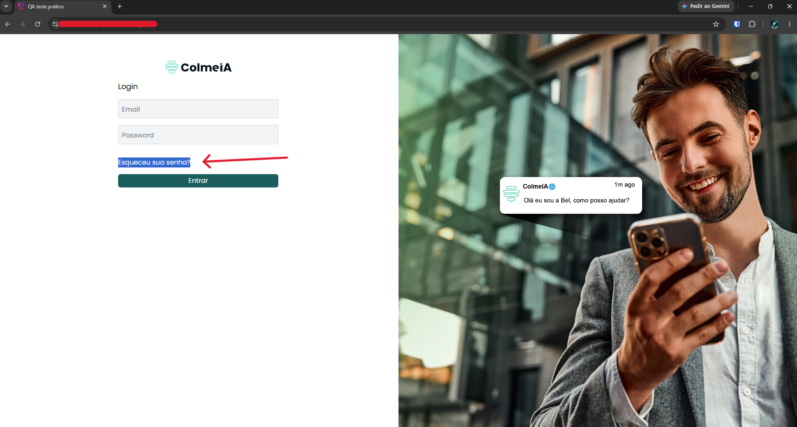

# TC-001 - Link "Esqueceu sua senha?" não funciona

## Cenário
Validar o funcionamento do link "Esqueceu sua senha?" na tela de login.

## Pré-condições
- Usuário na tela de login.

## Passos para reprodução
1. Clicar no link "Esqueceu sua senha?".

## Resultado observado
Nenhuma ação é executada após o clique no link.

## Resultado esperado
O sistema deve iniciar o fluxo de recuperação de senha, apresentando uma tela, modal ou outra opção que permita ao usuário prosseguir com a recuperação da senha.

## Evidências

## Observações
Nenhuma.

---

[← Voltar para o README](../README.md)