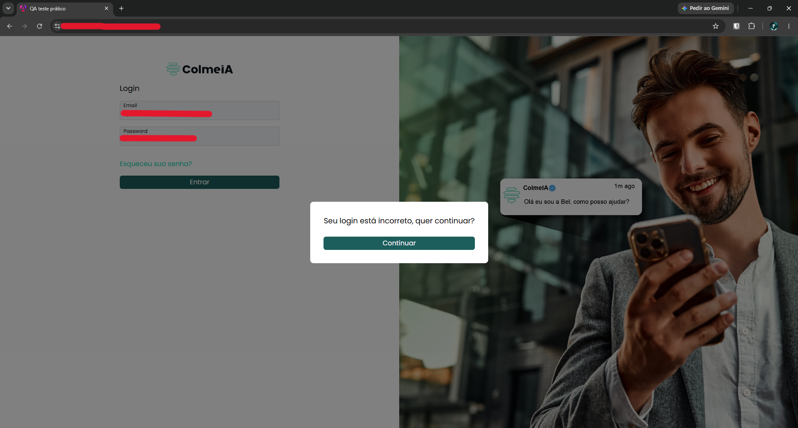

# TC-002 - Login válido exibe mensagem de erro

## Cenário
Validar o funcionamento do login utilizando credenciais válidas.

## Pré-condições
- Usuário na tela de login.
- Credenciais válidas fornecidas pela empresa.

## Passos para reprodução
1. Preencher os campos "Email" e "Password" com as credenciais válidas.
2. Clicar no botão "Entrar".

## Resultado observado
Uma mensagem com o texto "Seu login está incorreto, quer continuar?" e o botão "Continuar" é exibida na tela, mesmo com a utilização de credenciais válidas.

## Resultado esperado
O sistema deve autenticar o usuário sem exibir uma mensagem de erro e direcioná-lo para a tela de dashboard.

## Evidências

## Observações
Nenhuma.

---

[← Voltar para o README](../README.md)