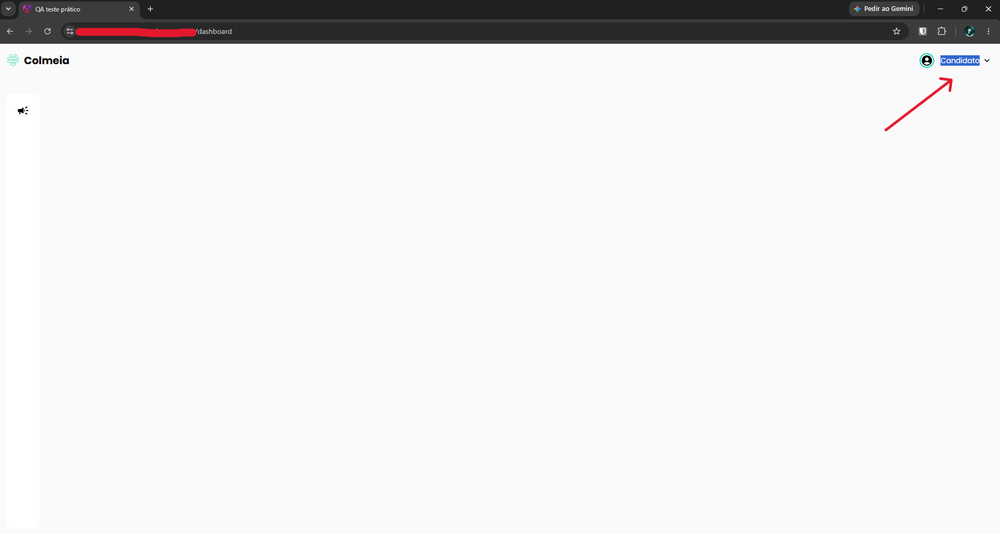

# TC-003 - Menu do usuário não responde

## Cenário
Validar o funcionamento do menu do usuário.

## Pré-condições
- Usuário autenticado no sistema.

## Passos para reprodução
1. No canto superior direito da tela, clicar no nome do usuário, no ícone de perfil ou na seta direcionada para baixo.

## Resultado observado
Nenhuma ação é executada após o clique nos elementos do menu do usuário.

## Resultado esperado
O sistema deve abrir o menu do usuário e exibir as opções disponíveis.

## Evidências

## Observações
Não foi identificada uma opção visível para sair da conta. Essa ausência pode estar relacionada ao não funcionamento do menu do usuário.

---

[← Voltar para o README](../README.md)