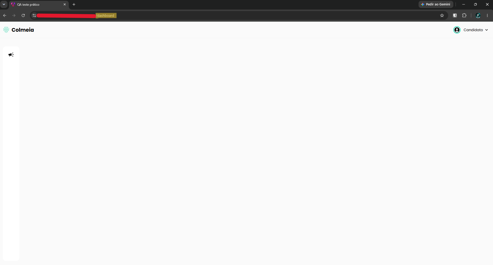

# TC-004 - Dashboard não exibe conteúdo

## Cenário
Validar a exibição da tela de dashboard.

## Pré-condições
- Usuário autenticado no sistema.

## Passos para reprodução
1. Acessar a tela de dashboard.

## Resultado observado
A área principal da tela permanece vazia, sem exibir conteúdo ou qualquer mensagem informativa.

## Resultado esperado
O sistema deve exibir o conteúdo correspondente ao dashboard ou, caso não existam dados disponíveis, apresentar uma mensagem ou estado informativo ao usuário.

## Evidências

## Observações
Apenas os menus de navegação lateral e do usuário permanecem visíveis na tela.

---

[← Voltar para o README](../README.md)