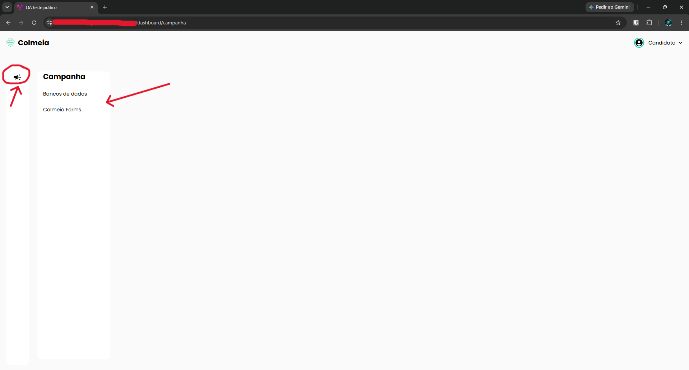

# TC-005 - Menu "Campanha" não pode ser recolhido

## Cenário
Validar a abertura e o recolhimento do menu "Campanha".

## Pré-condições
- Usuário autenticado no sistema.

## Passos para reprodução
1. Clicar no ícone de megafone, localizado no canto esquerdo da tela, para abrir o menu "Campanha".
2. Clicar novamente no ícone de megafone.

## Resultado observado
O menu permanece aberto e nenhuma ação é executada após o segundo clique.

## Resultado esperado
O sistema deve permitir que o usuário recolha o menu "Campanha", seja por meio do mesmo ícone utilizado para abri-lo ou por outro controle visível.

## Evidências

## Observações
Não foi identificado outro controle visível para recolher o menu.

---

[← Voltar para o README](../README.md)