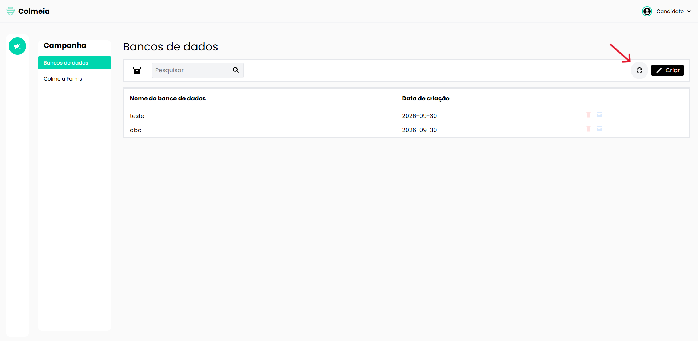
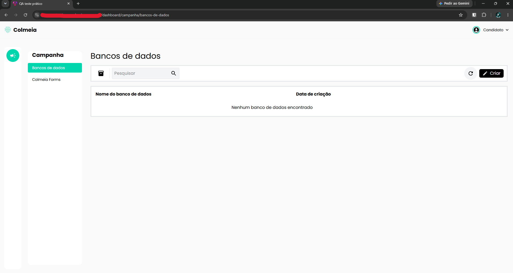

# TC-006 - Dados não são persistidos

## Cenário
Validar se o sistema persiste os dados adicionados na tela de "Bancos de dados".

## Pré-condições
- Usuário autenticado no sistema.
- Usuário na tela de "Bancos de dados", acessada pelo caminho "Campanha > Bancos de dados".

## Passos para reprodução
1. Clicar no botão "Criar".
2. Preencher o nome do novo item e salvar.
3. Confirmar que o item foi adicionado à lista.
4. Atualizar a página, atualizar a lista de bancos de dados ou navegar para outra tela e retornar.

## Resultado observado
Após a ação realizada, a lista é limpa e os itens cadastrados anteriormente deixam de ser exibidos.

## Resultado esperado
O sistema deve persistir os itens cadastrados e mantê-los disponíveis após a atualização da página ou a navegação entre telas.

## Evidências

## Observações
Nenhuma.

---

[← Voltar para o README](../README.md)