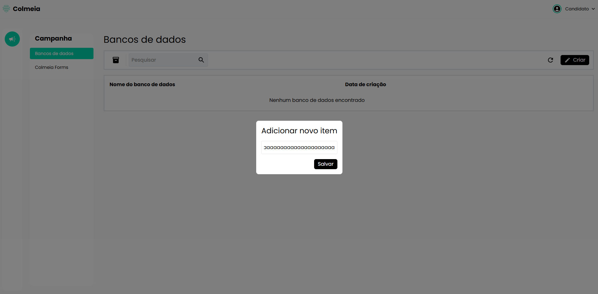
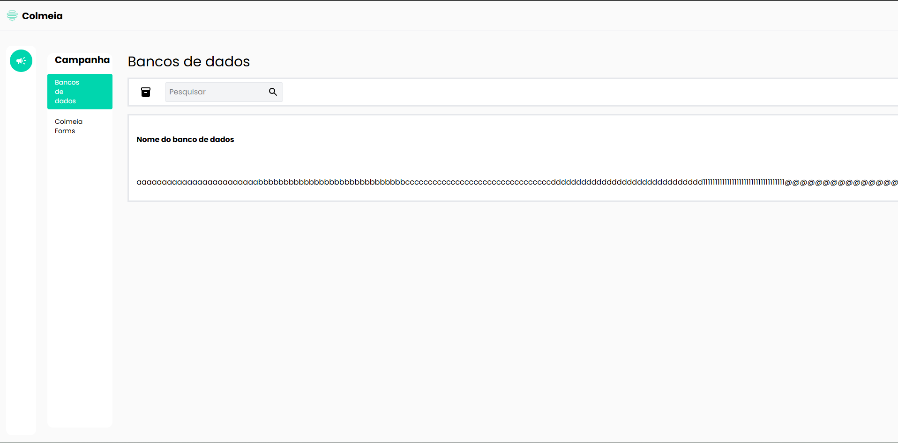

# TC-007 - Nome extenso sem espaços quebra o layout

## Cenário
Validar a exibição de itens com nomes extensos na tela de "Bancos de dados".

## Pré-condições
- Usuário autenticado no sistema.
- Usuário na tela de "Bancos de dados", acessada pelo caminho "Campanha > Bancos de dados".

## Passos para reprodução
1. Clicar no botão "Criar".
2. Preencher o nome do novo item com uma sequência extensa de caracteres sem espaços.
3. Salvar o item.
4. Confirmar que o item foi adicionado à lista.

## Resultado observado
Ao cadastrar um item com uma sequência extensa de caracteres sem espaços, o conteúdo não é tratado adequadamente e provoca deformação na estrutura da lista, comprometendo o layout da tela.

## Resultado esperado
O sistema deve tratar entradas extensas de texto sem comprometer a estrutura visual da página, utilizando limitação de caracteres, quebra adequada de conteúdo ou outro tratamento compatível com o layout.

## Evidências

## Observações
O problema ocorre de forma mais evidente quando o nome é composto por uma sequência extensa de caracteres sem espaços.

Quando é utilizado um texto longo contendo espaços, o layout apresenta apenas uma deformação menor, com deslocamento dos demais elementos da lista.

Também foi observado que o campo de nome, exibido durante a criação do item, não apresenta limite aparente de caracteres.

---

[← Voltar para o README](../README.md)