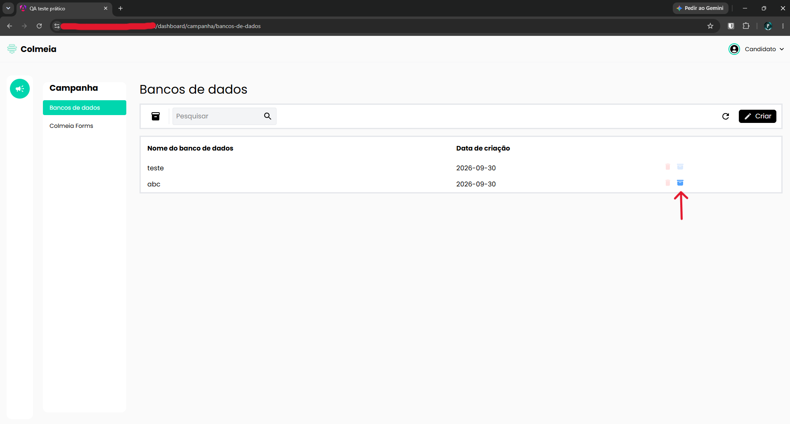
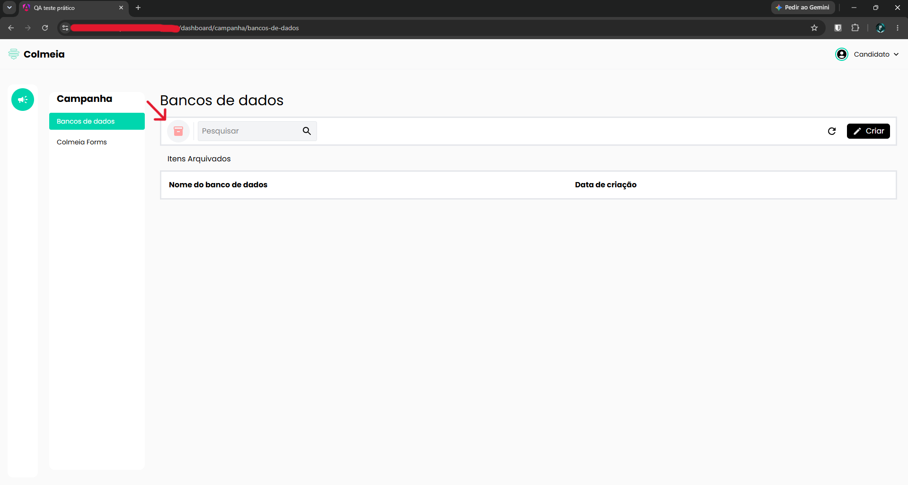

# TC-008 - Arquivamento não funciona

## Cenário
Validar a funcionalidade de arquivamento de itens na tela de "Bancos de dados".

## Pré-condições
- Usuário autenticado no sistema.
- Usuário na tela de "Bancos de dados", acessada pelo caminho "Campanha > Bancos de dados".
- Pelo menos um item criado e exibido na lista.

## Passos para reprodução
1. No item listado, clicar no ícone de arquivamento localizado no canto direito do item.
2. Clicar no ícone de itens arquivados, localizado ao lado do campo de pesquisa, na barra superior da tela de "Bancos de dados".

## Resultado observado
Após arquivar o item e acessar a área de itens arquivados, nenhum item é exibido.

## Resultado esperado
O sistema deve exibir na área de itens arquivados os itens que foram arquivados anteriormente.

## Evidências

## Observações
O comportamento observado pode estar relacionado ao problema de persistência descrito no TC-006.

---

[← Voltar para o README](../README.md)