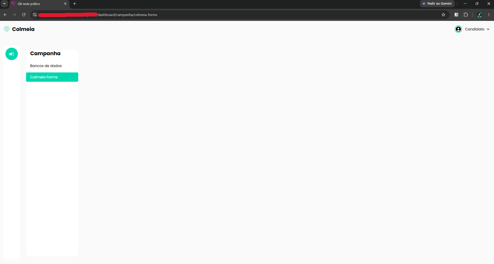

# TC-009 - Colmeia Forms não exibe conteúdo

## Cenário
Validar a exibição da tela "Colmeia Forms".

## Pré-condições
- Usuário autenticado no sistema.

## Passos para reprodução
1. Acessar a tela "Colmeia Forms" pelo caminho "Campanha > Colmeia Forms".

## Resultado observado
A área principal da tela permanece vazia e nenhum conteúdo ou mensagem informativa é exibido.

## Resultado esperado
O sistema deve exibir o conteúdo correspondente à funcionalidade "Colmeia Forms" ou, caso não existam dados disponíveis, apresentar uma mensagem ou estado informativo ao usuário.

## Evidências

## Observações
Nenhuma.

---

[← Voltar para o README](../README.md)