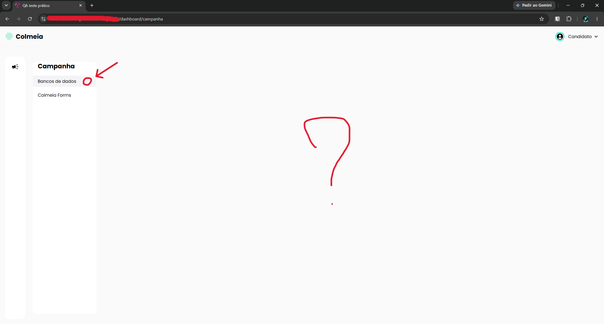
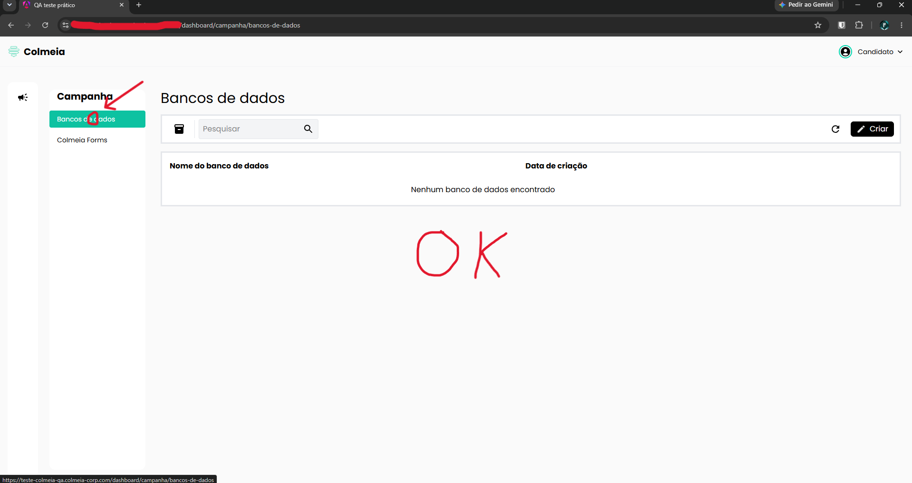

# TC-010 - Área clicável dos itens do menu é limitada ao texto

## Cenário
Validar a área clicável dos itens do menu "Campanha".

## Pré-condições
- Usuário autenticado no sistema.
- Menu "Campanha" aberto.

## Passos para reprodução
1. Em um dos itens do menu "Campanha", clicar em uma área do botão que não contenha texto.
2. Em seguida, clicar diretamente sobre o texto do mesmo item.

## Resultado observado
Ao clicar na área do botão sem texto, nenhuma ação é executada.

Ao clicar diretamente sobre o texto, a opção é acionada normalmente.

## Resultado esperado
Toda a área visual correspondente ao item do menu deve ser clicável, e não apenas o texto.

## Evidências

## Observações
O comportamento reduz a área de interação disponível e pode prejudicar a usabilidade da navegação.

---

[← Voltar para o README](../README.md)