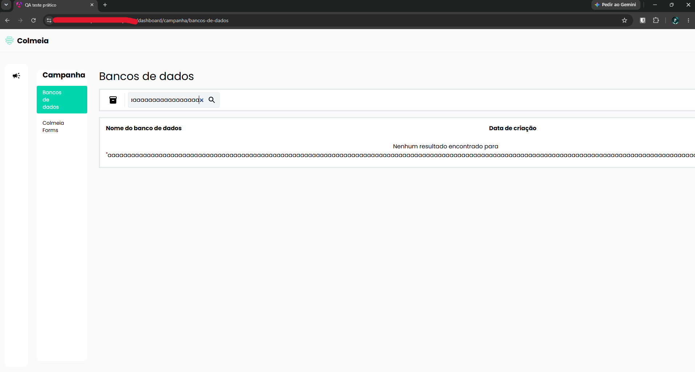

# TC-011 - Pesquisa com texto extenso quebra o layout

## Cenário
Validar o comportamento do campo de pesquisa da tela de "Bancos de dados" ao receber textos extensos.

## Pré-condições
- Usuário autenticado no sistema.
- Usuário na tela de "Bancos de dados", acessada pelo caminho "Campanha > Bancos de dados".

## Passos para reprodução
1. Localizar o campo de pesquisa da tela de "Bancos de dados".
2. Inserir uma sequência extensa de caracteres sem espaços no campo de pesquisa.

## Resultado observado
Ao inserir uma sequência extensa de caracteres sem espaços, o conteúdo não é tratado adequadamente e provoca deformação na estrutura da página.

## Resultado esperado
O sistema deve tratar entradas extensas no campo de pesquisa sem comprometer o layout da tela, utilizando limitação de caracteres, truncamento, quebra adequada de conteúdo ou outro tratamento compatível com a interface.

## Evidências

## Observações
O problema ocorre de forma mais evidente quando é utilizada uma sequência longa de caracteres sem espaços.

Quando é utilizado um texto extenso contendo espaços, a deformação é menos perceptível, ocorrendo apenas um pequeno deslocamento dos elementos da tela.

O campo de pesquisa não apresenta limite aparente de caracteres.

---

[← Voltar para o README](../README.md)